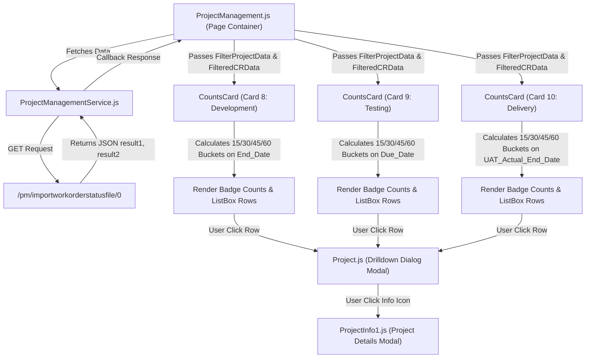

# Legacy Application Analysis — Upcoming Completion Days Logic
**(Development, Testing, and Delivery Completion)**

## 1. Executive Summary

This document provides a complete, authoritative technical and business-logic analysis of the **"Upcoming Days Completion"** features in the legacy application (`ARCO-RE-UI-TOSS`). 

The feature comprises three distinct metric cards displayed on the **Project Monitoring** dashboard:
1. **Development Completion in Upcoming Days** (Card 8)
2. **Testing Completion in Upcoming Days** (Card 9)
3. **Delivery Completion in Upcoming Days** (Card 10)

Each card categorizes upcoming project or change request completions into four time-window buckets:
* **In Next 15 Days**
* **In Next 30 Days**
* **In Next 45 Days**
* **In Next 60 Days**

> [!IMPORTANT]
> **CRITICAL REQUIREMENT**: The values rendered in the legacy UI are dynamically calculated from live API responses. A new application implementing this feature MUST NEVER hardcode values or copy static screenshot counts. The new application must implement the exact API integration, data mapping, date filtering, and cumulative bucket aggregation logic specified in this document.

---

## 2. Feature Scope

| Card ID | Card Title | Target Domain | Dataset Evaluated | Primary Date Field | Metric Type |
| :--- | :--- | :--- | :--- | :--- | :--- |
| **Card 8** | Development Completion in Upcoming days | Change Requests (CR) | `CRData` (`res.result2`) | `End_Date` | Record Count (Integer) |
| **Card 9** | Testing Completion in Upcoming days | Work Orders (WO / Projects) | `FilterProjectData` (`res.result1`) | `Due_Date` | Record Count (Integer) |
| **Card 10** | Delivery Completion in Upcoming days | Work Orders (WO / Projects) | `FilterProjectData` (`res.result1`) | `UAT_Actual_End_Date` | Record Count (Integer) |

---

## 3. Legacy Source Files

The implementation of this feature is spread across the following primary source files:

| File Role | Basename | Absolute File Path | Key Functions / Responsibilities |
| :--- | :--- | :--- | :--- |
| **Parent Page** | `ProjectManagement.js` | [ProjectManagement.js](file:///c:/git/toss/ARCO-RE-UI-TOSS/src/Components/ProjectManagement/ProjectManagement.js) | Fetches API data, performs initial data normalization (`buildProjectData`), handles global Project Type filters (`onProjectTypeChange`), and passes state props to cards. |
| **Card Component** | `CountsCard.js` | [CountsCard.js](file:///c:/git/toss/ARCO-RE-UI-TOSS/src/Components/ProjectManagement/CountsCard.js) | Performs date math, filters records into 15/30/45/60-day cumulative buckets in `loadComponentData()`, renders badge counts, and handles click-to-drilldown. |
| **Drilldown Modal** | `Project.js` | [Project.js](file:///c:/git/toss/ARCO-RE-UI-TOSS/src/Components/ProjectManagement/Project.js) | Renders the data table dialog listing the specific records belonging to the clicked bucket. |
| **Project Detail Modal** | `ProjectInfo1.js` | [ProjectInfo1.js](file:///c:/git/toss/ARCO-RE-UI-TOSS/src/Components/ProjectManagement/ProjectInfo1.js) | Displays deep single-project detail view when an info icon is clicked inside the drilldown table. |
| **API Service** | `ProjectManagementService.js` | [ProjectManagementService.js](file:///c:/git/toss/ARCO-RE-UI-TOSS/src/Components/Services/ProjectManagementService.js) | Encapsulates endpoint construction for `importworkorderstatusfile`. |
| **HTTP Transport** | `OSSRequest.js` | [OSSRequest.js](file:///c:/git/toss/ARCO-RE-UI-TOSS/src/Components/Utils/OSSRequest.js) | Executes XMLHttpRequest `GET` request, appends cache-buster query parameter (`rnd`), and attaches Bearer tokens. |
| **App Initializer** | `OSSSystem.js` | [OSSSystem.js](file:///c:/git/toss/ARCO-RE-UI-TOSS/src/OSSSystem.js) | Configures base API controllers (`/pm`) and global services. |
| **Localization** | `TextContent.js` | [TextContent.js](file:///c:/git/toss/ARCO-RE-UI-TOSS/src/Languages/TextContent.js) | Defines i18n title keys: `DevelopmentCompletionInUpcomingDays`, `TestingCompletionInUpcomingDays`, `DeliveryCompletionInUpcomingDays`. |

---

## 4. Component Architecture



### Component State & Props Mapping

#### `ProjectManagement.js` State
* `projectData`: Mapped array of Work Orders (`result1`).
* `CRData`: Raw array of Change Requests (`result2`).
* `FilterProjectData`: Filtered subset of Work Orders (affected by `selectedPM` radio button filter).
* `FilteredCRData`: Filtered subset of Change Requests (matching WOs in `FilterProjectData`).
* `selectedPM`: Selected project type radio button (Default: `"All Projects"`).

#### `CountsCard.js` Props & State
* Props received:
  * `cardid`: `8`, `9`, or `10`.
  * `title`: Card title text from `OSSSystem.TextEngine`.
  * `data`: `this.state.FilterProjectData` (Work Orders array).
  * `crdata`: `this.state.FilteredCRData` (CR array).
* Internal State:
  * `groupedList`: Array of 4 bucket objects: `[{ name: "In Next 15 Days", count: N, ProjList: [...] }, ...]`
  * `showProjects`: Boolean controlling visibility of `Project.js` drilldown dialog.
  * `selectedItem`: The clicked bucket object passed to `Project.js`.

---

## 5. API Integration & Request Details

### Endpoint Specification

| Attribute | Details |
| :--- | :--- |
| **HTTP Method** | `GET` |
| **Endpoint Path** | `/pm/importworkorderstatusfile/0` |
| **Full URL** | `${AppConfig.api.url}/pm/importworkorderstatusfile/0?rnd=${Math.random()}` |
| **Frontend Service Method** | `OSSSystem.services.projectManagementService.getProjectManagementData(afterResponse)` |
| **HTTP Client Library** | Native `XMLHttpRequest` via `OSSRequest.getJson()` |
| **Path Parameters** | `0` (hardcoded dummy ID parameter required by backend route pattern) |
| **Query Parameters** | `rnd` (floating-point random number generated by `appendRandomValueToBypassCache()` to prevent browser/proxy caching) |
| **Request Body** | *None* |
| **Headers** | `Authorization: Bearer ${OSSSystem.Token}`<br>`x-auth-token: ${this.authToken}` (if set) |
| **Authentication** | Required (JWT Bearer Token) |
| **Invocation Trigger** | Called automatically on page load in `ProjectManagement.js` lifecycle method `componentDidMount()`. |
| **Re-invocation** | Not re-called on client-side filter changes (filters operate in-memory on the loaded dataset). |

---

## 6. API Response Structure

The endpoint `/pm/importworkorderstatusfile/0` returns a JSON object containing two main data arrays:

```json
{
  "isSuccess": true,
  "result1": [
    {
      "Wo_Id": "101",
      "Ipm_Number": "IPM-2026-001",
      "Summary": "Core Banking System Upgrade",
      "Status": "In Progress",
      "Start_Date": "2026-01-15",
      "Due_Date": "2026-09-10",
      "UAT_Actual_End_Date": "2026-09-25",
      "SIT_Received_date": "2026-08-01",
      "IT_Delivery_Lead": "John Doe",
      "Product_Owner": "Jane Smith",
      "Depends_On": "Core Banking"
    }
  ],
  "result2": [
    {
      "Wo_Id": 101,
      "Cr_Id": "CR-501",
      "Ipm_Number": "IPM-2026-001",
      "Summary": "Database Indexing & API Refactoring",
      "Status": "Development In Progress",
      "Start_Date": "2026-02-01",
      "End_Date": "2026-08-30",
      "Effort_in_MDs": "12",
      "Assigned_Developer": "Alice Johnson",
      "Additional_Developers": "Bob Wilson"
    }
  ]
}
```

### Dataset Usage Overview
* `result1` represents **Work Orders / Projects**. It is stored in `projectData` and passed as the `data` prop to `CountsCard`.
* `result2` represents **Change Requests (CRs)** linked to Work Orders by `Wo_Id`. It is stored in `CRData` and passed as the `crdata` prop to `CountsCard`.

---

## 7. Data Field Mapping

The precise mapping between business metrics, API fields, transformations, and target components is as follows:

| Business Metric | Target Card | Dataset Source | API Field Name | Field Data Type | Transformation Applied | Used For |
| :--- | :--- | :--- | :--- | :--- | :--- | :--- |
| **Development Date** | Card 8 | `CRData` (`result2`) | `End_Date` | String (`YYYY-MM-DD` or ISO string) | Parsed via `new Date(x.End_Date)` | Evaluates Development Completion |
| **Testing Date** | Card 9 | `FilterProjectData` (`result1`) | `Due_Date` | String (`YYYY-MM-DD` or ISO string) | Parsed via `new Date(x.Due_Date)` | Evaluates Testing Completion |
| **Delivery Date** | Card 10 | `FilterProjectData` (`result1`) | `UAT_Actual_End_Date` | String (`YYYY-MM-DD` or ISO string) | Parsed via `new Date(x.UAT_Actual_End_Date)` | Evaluates Delivery Completion |
| **Work Order Link ID** | Cards 8, 9, 10 | `result1` & `result2` | `Wo_Id` | String / Number | Parsed via `parseInt(myrow.Wo_Id)` | Joins CRs to WOs during project-type filtering and modal drilldown |
| **Project Type Filter** | Cards 8, 9, 10 | `result1` | `Depends_On` | String | If length == 1 or empty string, normalized to `"Not Available"` | Filters Work Orders and linked CRs by selected system radio button |
| **Status Name** | Project Table | `result1` | `Status` | String | Matched against `StaticData.PMStatus` to assign `StatusId` & `StatusGroup` | Status categorization and display |

---

## 8. Development Completion Logic (Card 8)

### Target Dataset
* Evaluates **Change Request Data** (`crdata` / `FilteredCRData`).

### Target Date Field
* Uses `x.End_Date` from each Change Request object in `crdata`.

### Calculation Workflow
1. Obtain current client timestamp: `today = new Date()`.
2. Compute day multiplier constant: `dayDivisionVal = 24 * 60 * 60 * 1000` (86,400,000 ms).
3. Compute upper boundary timestamps:
   * `next15D = new Date(today.getTime() + 15 * dayDivisionVal)`
   * `next30D = new Date(today.getTime() + 30 * dayDivisionVal)`
   * `next45D = new Date(today.getTime() + 45 * dayDivisionVal)`
   * `next60D = new Date(today.getTime() + 60 * dayDivisionVal)`
4. Iterate over each Change Request `x` in `FilteredCRData`:
   * Parse target date: `myDateValue = new Date(x.End_Date)`.
   * **In Next 15 Days**: If `today <= myDateValue && myDateValue <= next15D`, push `x` to `next15Days`.
   * **In Next 30 Days**: If `today <= myDateValue && myDateValue <= next30D`, push `x` to `next30Days`.
   * **In Next 45 Days**: If `today <= myDateValue && myDateValue <= next45D`, push `x` to `next45Days`.
   * **In Next 60 Days**: If `today <= myDateValue && myDateValue <= next60D`, push `x` to `next60Days`.
5. Aggregate array lengths (`next15Days.length`, etc.) into state `groupedList`.

---

## 9. Testing Completion Logic (Card 9)

### Target Dataset
* Evaluates **Work Order Data** (`data` / `FilterProjectData`).

### Target Date Field
* Uses `x.Due_Date` from each Work Order object in `FilterProjectData`.

### Calculation Workflow
1. Follows the exact same timestamp boundary calculation (`today`, `next15D`, `next30D`, `next45D`, `next60D`).
2. Iterate over each Work Order `x` in `FilterProjectData`:
   * Parse target date: `myDateValue = new Date(x.Due_Date)`.
   * Evaluates `today <= myDateValue && myDateValue <= nextND` for N = 15, 30, 45, 60.
3. Aggregate array lengths into state `groupedList`.

---

## 10. Delivery Completion Logic (Card 10)

### Target Dataset
* Evaluates **Work Order Data** (`data` / `FilterProjectData`).

### Target Date Field
* Uses `x.UAT_Actual_End_Date` from each Work Order object in `FilterProjectData`.

### Calculation Workflow
1. Follows the exact same timestamp boundary calculation (`today`, `next15D`, `next30D`, `next45D`, `next60D`).
2. Iterate over each Work Order `x` in `FilterProjectData`:
   * Parse target date: `myDateValue = new Date(x.UAT_Actual_End_Date)`.
   * Evaluates `today <= myDateValue && myDateValue <= nextND` for N = 15, 30, 45, 60.
3. Aggregate array lengths into state `groupedList`.

---

## 11. 15 / 30 / 45 / 60 Day Bucket Logic & Boundary Rules

### Bucket Behavior: Cumulative vs Range

> [!IMPORTANT]
> The four day-buckets in the legacy application are **CUMULATIVE (inclusive threshold windows)**, NOT independent non-overlapping ranges.

* **In Next 15 Days**: Records where `today <= date <= today + 15 days`.
* **In Next 30 Days**: Records where `today <= date <= today + 30 days` *(includes all records in the 15-day bucket plus records in days 16–30)*.
* **In Next 45 Days**: Records where `today <= date <= today + 45 days` *(includes all records from 0–15, 16–30, and 31–45 days)*.
* **In Next 60 Days**: Records where `today <= date <= today + 60 days` *(includes all records from 0–60 days)*.

### Mathematical Definition

$$ \text{Bucket}(N) = \{ x \in D \mid \text{today} \le \text{Date}(x) \le \text{today} + N \times 86,400,000\text{ ms} \} $$

Where:
* $N \in \{15, 30, 45, 60\}$
* $D = \text{CRData}$ for Card 8
* $D = \text{FilterProjectData}$ for Cards 9 and 10

### Boundary Inclusion Rules

* **Lower Boundary (`today <= myDateValue`)**:
  * An item with a timestamp equal to or greater than `today` is **included**.
  * Past dates (`myDateValue < today`) are **strictly excluded**.
* **Upper Boundary (`myDateValue <= nextND`)**:
  * An item with a timestamp exactly equal to `today + N days` is **included**.
  * Dates beyond `today + N days` are **excluded**.

---

## 12. Display Metric Meaning (Count vs Percentage)

* **Metric Type**: **RECORD COUNT** (integer length of filtered array).
* **Displayed Value**: `next15Days.length`, `next30Days.length`, `next45Days.length`, `next60Days.length`.
* **UI Representation**: Rendered as a green PrimeReact Badge (`<Badge bg="success">`) inside a ListBox row.
* **Formula**:
  $$\text{Count} = \sum_{x \in D} \begin{cases} 1 & \text{if } \text{today} \le \text{Date}(x) \le \text{today} + N \text{ days} \\ 0 & \text{otherwise} \end{cases}$$
* **What it is NOT**:
  * It is NOT a percentage.
  * It is NOT a ratio against total projects.
  * It is NOT a completion percentage.

---

## 13. Filtering Rules and Business Logic

### 1. Global Project Type Filter (`selectedPM`)
User interaction with the project type radio buttons in `ProjectManagement.js` alters the inputs to `CountsCard`:
* When **"All Projects"** is selected (Default):
  * `FilterProjectData` = All Work Orders (`projectData`).
  * `FilteredCRData` = All Change Requests (`CRData`).
* When a **Specific System / Project Type** (e.g. `"System A"`) is selected:
  * `FilterProjectData` = `projectData.filter(prj => prj.Depends_On === selectedPM)`
  * `filteredProjIds` = `FilterProjectData.map(obj => obj.Wo_Id)`
  * `FilteredCRData` = `CRData.filter(cr => filteredProjIds.includes(cr.Wo_Id))`

### 2. Card-Level In-Memory Date Filtering
Inside `CountsCard.js`:
* No project status filter is applied for Cards 8, 9, and 10 (unlike Breach cards). All statuses returned by the API are evaluated.
* Only the date comparison `today <= myDateValue && myDateValue <= nextND` filters the dataset.

---

## 14. Frontend vs Backend Responsibility

```text
Backend Responsibility:
    └─ Exposes GET /pm/importworkorderstatusfile/0
    └─ Returns raw JSON object containing result1 (Work Orders) and result2 (Change Requests)
    └─ Performs no date filtering or bucket categorization for Cards 8, 9, 10

Frontend Responsibility:
    └─ Invokes API via OSSRequest
    └─ Parses Wo_Id strings to integers
    └─ Maps Status names to StatusId and StatusGroup
    └─ Normalizes Depends_On strings
    └─ Filters datasets based on selected project type radio button
    └─ Evaluates current local timestamp (new Date())
    └─ Computes 15, 30, 45, 60-day upper bound timestamps
    └─ Performs array iteration and date comparison
    └─ Categorizes records into cumulative arrays
    └─ Calculates array lengths (.length)
    └─ Renders PrimeReact ListBox cards with Badge counts
    └─ Manages modal state and drilldown table rendering
```

---

## 15. Date & Time Rules

### Date Parsing
* JavaScript `new Date(dateString)` is used directly on `x.End_Date`, `x.Due_Date`, and `x.UAT_Actual_End_Date`.
* ISO format (`YYYY-MM-DD` or `YYYY-MM-DDTHH:mm:ss`) strings are expected.

### Time Component Quirk / Legacy Behavior

> [!WARNING]
> **Timezone & Time-of-Day Legacy Quirk**:
> In `CountsCard.js:L128`, `today` is instantiated as `new Date()`, which includes the current hours, minutes, seconds, and milliseconds at execution time (e.g., `2026-08-19 18:04:11.500`).
>
> When a date-only string like `"2026-08-19"` is passed to `new Date("2026-08-19")`, JavaScript parses it as UTC Midnight (`2026-08-19 00:00:00.000 UTC`), which converts in local time to local midnight or early morning.
>
> If the current time is `18:04`, `today` (`18:04`) is GREATER than `myDateValue` (`00:00`), causing `today <= myDateValue` to evaluate to `FALSE`. Consequently, records due on the current day (`today`) may be excluded if checked after 00:00 AM.
>
> **Parity Contract**: The new application MUST be aware of this behavior and handle start-of-day normalization cleanly (`setHours(0, 0, 0, 0)`).

---

## 16. Null, Empty, and Error Handling

| Scenario | Code Path / Evaluated Expression | Legacy Result | UI Behavior |
| :--- | :--- | :--- | :--- |
| **Null Date Field** | `new Date(null)` | Evaluates to `1970-01-01T00:00:00.000Z`. Since `1970 < today`, `today <= myDateValue` is `false`. | Record is silently excluded from all 4 buckets. |
| **Empty String Date (`""`)** | `new Date("")` | Evaluates to `Invalid Date` (`NaN`). Any comparison `today <= Invalid Date` evaluates to `false`. | Record is silently excluded from all 4 buckets. |
| **Undefined Date Field** | `new Date(undefined)` | Evaluates to `Invalid Date`. | Record is silently excluded from all 4 buckets. |
| **Invalid Date String** | `new Date("abc")` | Evaluates to `Invalid Date`. | Record is silently excluded from all 4 buckets. |
| **Empty API Array (`result1`/`result2` empty)** | `myDataList.forEach(...)` over empty array | Loop does not execute. `next15Days` remains empty array `[]`. | Card renders all 4 rows with count `0`. |
| **API Network Failure** | `res.isSuccess === false` or network error | `loading` set to `false`, PrimeReact Toast displays error notification. | Grid displays empty / 0 counts. |
| **Missing `Wo_Id` Link** | `filteredProjIds.includes(cr.Wo_Id)` | CR fails inclusion check in `FilteredCRData`. | CR excluded when project type filter is active. |

---

## 17. Complete End-to-End Data Flow

```text
1. Component Mount (ProjectManagement.js)
   ↓
2. Execute loadProjectManagementData()
   ↓
3. Call OSSSystem.services.projectManagementService.getProjectManagementData()
   ↓
4. OSSRequest sends GET to /pm/importworkorderstatusfile/0?rnd=0.123456
   ↓
5. Server returns HTTP 200 JSON: { isSuccess: true, result1: [...], result2: [...] }
   ↓
6. buildProjectData(result1) normalizes Wo_Id to integer and attaches StatusId/StatusGroup
   ↓
7. projectData = normalized result1, CRData = result2
   ↓
8. Extract unique project types via uniqueProjectType(projectData)
   ↓
9. Execute onProjectTypeChange("All Projects", projectData, PMStatusGroups, CRData)
   ↓
10. Set state: FilterProjectData = projectData, FilteredCRData = CRData
   ↓
11. Render CountsCard components for Card 8, Card 9, Card 10
   ↓
12. CountsCard.componentDidMount() triggers loadComponentData()
   ↓
13. Select target dataset: Card 8 uses crdata (CRData), Card 9 & 10 use data (FilterProjectData)
   ↓
14. Instantiates today = new Date() and calculates next15D, next30D, next45D, next60D
   ↓
15. For each record in dataset:
      Extract target date (End_Date / Due_Date / UAT_Actual_End_Date)
      Parse myDateValue = new Date(targetDate)
      Check today <= myDateValue <= nextND
      Push matching record to next15Days, next30Days, next45Days, next60Days arrays
   ↓
16. Construct groupedArray with names "In Next 15 Days", "In Next 30 Days", etc., and counts
   ↓
17. setState({ groupedList: groupedArray })
   ↓
18. Render PrimeReact ListBox with green Badge showing array lengths
   ↓
19. (Optional User Action): Click bucket row → onCountClick() → Open Project.js Dialog Modal
```

---

## 18. Real Data Calculation Example

### Input Data Context
* **Current Execution Time**: `2026-08-19T10:00:00.000Z` (`today`)
* **Calculated Upper Boundaries**:
  * `next15D`: `2026-09-03T10:00:00.000Z`
  * `next30D`: `2026-09-18T10:00:00.000Z`
  * `next45D`: `2026-10-03T10:00:00.000Z`
  * `next60D`: `2026-10-18T10:00:00.000Z`

### Sample Change Request Data (`result2` - for Card 8 Development Completion)

| CR ID | Summary | `End_Date` | `new Date(End_Date)` Timestamp | Evaluation vs Boundaries | Included in Buckets |
| :--- | :--- | :--- | :--- | :--- | :--- |
| `CR-101` | Backend Patch | `2026-08-25` | `2026-08-25T00:00:00.000Z` | $\text{today} \le \text{date} \le \text{next15D}$ | 15, 30, 45, 60 Days |
| `CR-102` | API Redesign | `2026-09-10` | `2026-09-10T00:00:00.000Z` | $\text{next15D} < \text{date} \le \text{next30D}$ | 30, 45, 60 Days |
| `CR-103` | Mobile UI Update | `2026-09-28` | `2026-09-28T00:00:00.000Z` | $\text{next30D} < \text{date} \le \text{next45D}$ | 45, 60 Days |
| `CR-104` | Security Audit | `2026-10-10` | `2026-10-10T00:00:00.000Z` | $\text{next45D} < \text{date} \le \text{next60D}$ | 60 Days |
| `CR-105` | Legacy Cleanup | `2026-11-15` | `2026-11-15T00:00:00.000Z` | $\text{date} > \text{next60D}$ | *None (Excluded)* |
| `CR-106` | Past Feature | `2026-07-01` | `2026-07-01T00:00:00.000Z` | $\text{date} < \text{today}$ | *None (Excluded)* |
| `CR-107` | Corrupted Entry | `""` | `Invalid Date` | Comparison returns `false` | *None (Excluded)* |

### Resulting UI Counts for Card 8

```text
Card Title: Development Completion in Upcoming days
├─ In Next 15 Days ──► Count: 1  (CR-101)
├─ In Next 30 Days ──► Count: 2  (CR-101, CR-102)
├─ In Next 45 Days ──► Count: 3  (CR-101, CR-102, CR-103)
└─ In Next 60 Days ──► Count: 4  (CR-101, CR-102, CR-103, CR-104)
```

---

## 19. Verification / Test Cases

To verify exact parity in a new application, implement the following automated or manual test cases:

| Test Case ID | Scenario | Input Condition | Expected Result |
| :--- | :--- | :--- | :--- |
| **TC-01** | Cumulative Bucket Accumulation | CR with `End_Date` = `today + 10 days` | Must be included in ALL 4 buckets (15, 30, 45, 60). Count increments by 1 for all 4. |
| **TC-02** | 30-Day Bucket Range | CR with `End_Date` = `today + 25 days` | Must be included in 30, 45, and 60 day buckets. Excluded from 15 day bucket. |
| **TC-03** | Past Date Exclusion | WO with `Due_Date` = `today - 1 day` | Must be EXCLUDED from all buckets. Count is 0. |
| **TC-04** | Future Beyond 60 Days | WO with `UAT_Actual_End_Date` = `today + 61 days` | Must be EXCLUDED from all buckets. Count is 0. |
| **TC-05** | Empty Date String | Record with date field `""` | Silently ignored. No NaN error, count remains 0. |
| **TC-06** | Null Date Field | Record with date field `null` | Silently ignored. Excluded from count. |
| **TC-07** | Project Type Filter Application | Select specific project type `Depends_On = "System B"` | Dataset filtered to matching WOs and linked CRs before bucket calculation. |
| **TC-08** | Card Metric Differentiation | Dataset where CR `End_Date` != WO `Due_Date` | Card 8 (CR End_Date) displays different counts than Card 9 (WO Due_Date). |

---

## 20. Files and Functions That Must Be Reused or Replicated

When re-implementing this feature in a new application framework (e.g. React modern hooks, Next.js, Vue, etc.), replicate the logic from the following legacy entities:

1. **API Service Call**:
   * Endpoint: `GET /pm/importworkorderstatusfile/0`
   * Method: Must fetch both Work Orders (`result1`) and Change Requests (`result2`).
2. **Data Normalization Function (`buildProjectData`)**:
   * Must convert `Wo_Id` to integer.
   * Must map status string to numeric status identifiers if required by downstream filters.
3. **Project Type Relationship Filter (`onProjectTypeChange`)**:
   * Must filter `result2` (CRs) based on `Wo_Id` values present in the filtered `result1` (Work Orders).
4. **Upcoming Days Bucket Calculator (`loadComponentData`)**:
   * Must replicate the cumulative date boundary checks:
     * Card 8: `CRData.End_Date`
     * Card 9: `WorkOrder.Due_Date`
     * Card 10: `WorkOrder.UAT_Actual_End_Date`

---

## 21. NEW APPLICATION PARITY CONTRACT

> [!IMPORTANT]
> **MANDATORY IMPLEMENTATION CONTRACT FOR NEW APPLICATION**:
>
> The NEW application must reproduce the exact business behavior and calculation logic of the OLD application, not merely reproduce its visual output.

### The NEW application MUST:
* Consume data dynamically from the API endpoint `/pm/importworkorderstatusfile/0`.
* Send the exact required request parameters and authentication headers (`Authorization: Bearer <token>`).
* Parse the response JSON containing `result1` (Work Orders) and `result2` (Change Requests).
* Perform **Development Completion** evaluation using `CRData.End_Date`.
* Perform **Testing Completion** evaluation using `WorkOrder.Due_Date`.
* Perform **Delivery Completion** evaluation using `WorkOrder.UAT_Actual_End_Date`.
* Calculate buckets using **CUMULATIVE** time windows (15, 30, 45, 60 days).
* Render counts as **integer record totals** (`array.length`).
* Handle empty strings, `null`, `undefined`, and invalid dates by excluding them from bucket counts without throwing runtime errors.
* Apply project-type radio button filters dynamically to both Work Orders and Change Requests before bucket evaluation.

### The NEW application MUST NOT:
* Hardcode legacy numbers or static display values.
* Copy static counts from screenshots or mock data.
* Create a second API when `/pm/importworkorderstatusfile/0` already provides the required data.
* Use non-cumulative (disjoint) ranges (e.g., 0–15, 16–30, 31–45, 46–60) unless explicitly requested.
* Convert record counts into percentages or ratios.
* Alter the underlying business meaning of Development, Testing, or Delivery completion.
